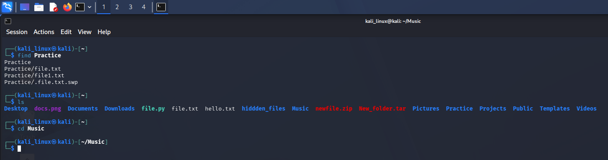
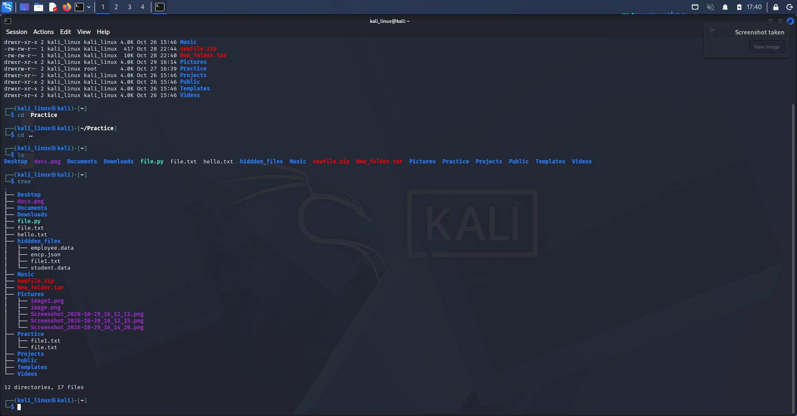

# Linux Navigation Commands

## 1. Introduction

Linux navigation commands help users explore the Linux filesystem, view directories, find files, and move between different locations using the terminal.

In this section, I practiced basic Linux navigation and directory-related commands using Kali Linux.

## 2. Commands Learned

### 1. `ls`

**Description:** Lists files and directories in the current directory.

**Syntax:**
```bash
ls
```

**Example:**
```bash
ls
```

**Use:** Displays the contents of the current directory.

### 2. `ls -l`

**Description:** Displays files and directories in long-list format.

**Syntax:**
```bash
ls -l
```

**Use:** Shows permissions, owner, group, file size, and modification date.

### 3. `ls -a`

**Description:** Displays all files, including hidden files.

**Syntax:**
```bash
ls -a
```

**Use:** Shows hidden files and directories that start with a dot (`.`).

### 4. `pwd`

**Description:** Displays the current working directory.

**Syntax:**
```bash
pwd
```

**Use:** Helps identify the current location in the filesystem.

### 5. `cd`

**Description:** Changes the current working directory.

**Syntax:**
```bash
cd directory_name
```

**Example:**
```bash
cd Documents
```

**Use:** Moves into another directory.

### 6. `cd ..`

**Description:** Moves one level up to the parent directory.

**Syntax:**
```bash
cd ..
```

**Use:** Returns to the parent directory.

### 7. `tree`

**Description:** Displays directories and files in a tree-like structure.

**Syntax:**
```bash
tree
```

**Example:**
```bash
tree Documents
```

**Use:** Helps understand the folder structure visually.

### 8. `find`

**Description:** Searches for files and directories based on specified conditions.

**Syntax:**
```bash
find path -name "filename"
```

**Example:**
```bash
find . -name "notes.txt"
```

**Use:** Searches for a file by name within a specified location.

### 9. `locate`

**Description:** Finds files and directories using a database of file locations.

**Syntax:**
```bash
locate filename
```

**Example:**
```bash
locate notes.txt
```

**Use:** Quickly searches for files using an indexed database.

### 10. `which`

**Description:** Shows the location of an executable command.

**Syntax:**
```bash
which command_name
```

**Example:**
```bash
which python
which ls
```

**Use:** Identifies where an executable command is located.

### 11. `ls -ls`

**Description:** Displays directory contents in long-list format with file sizes in blocks.

**Syntax:**
```bash
ls -ls
```

**Use:** Shows file details and the number of allocated filesystem blocks.

---

## 3. Evidences

Screenshots of my practical Linux terminal exercises are stored in the `Evidence_image`directory.


### Screenshot 1: Linux Terminal



### Screenshot 2: Linux Terminal



### Screenshot 3: Linux Terminal


## 4. What I Learned

- How to navigate the Linux filesystem.
- How to list files and directories.
- How to view hidden files.
- How to check the current working directory.
- How to move between directories.
- How to search for files and directories.
- How to identify executable command locations.
- How to understand directory structures.


**Learning Status:** Practiced

**Operating System:** Kali Linux

**Category:** Linux Fundamentals