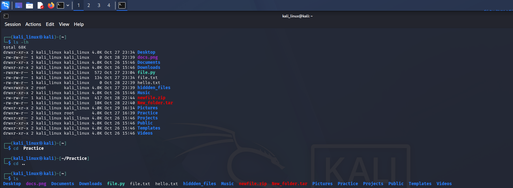
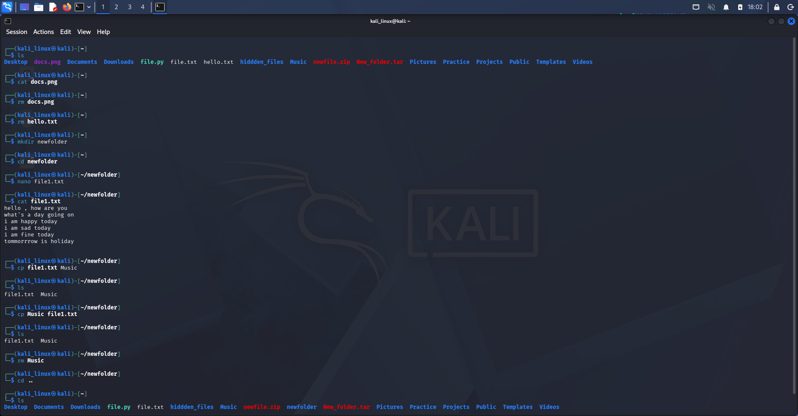

# Linux File Operations

## 1. Introduction

File operations in Linux help users create, copy, move, rename, and delete files and directories using the terminal. They also help users create folders and check file information.

In this section, I practiced basic file operation commands using Kali Linux.

## 2. Commands Learned

### 1. `cp`

**Description:** Copies a file from one location to another.

**Syntax:**
```bash
cp source_file destination
```

**Example:**
```bash
cp notes.txt notes-copy.txt
```

**Use:** Creates a copy of a file.

### 2. `cp -r`

**Description:** Copies a directory and its contents recursively.

**Syntax:**
```bash
cp -r source_directory destination
```

**Example:**
```bash
cp -r Project Project-copy
```

**Use:** Copies a directory, including the files and subdirectories inside it.

### 3. `mv`

**Description:** Moves a file or directory to another location, or renames it.

**Syntax:**
```bash
mv source destination
```

**Examples:**
```bash
mv notes.txt Documents/
mv old-name.txt new-name.txt
```

**Use:** Moves files or directories and renames them when needed.

### 4. `rm`

**Description:** Removes a file.

**Syntax:**
```bash
rm filename
```

**Example:**
```bash
rm test.txt
```

**Use:** Deletes a file. Check the filename carefully before using this command.

### 5. `rm -r`

**Description:** Removes a directory and its contents recursively.

**Syntax:**
```bash
rm -r directory_name
```

**Example:**
```bash
rm -r test-folder
```

**Use:** Deletes a directory and the files and subdirectories inside it. Practice only with test folders because deleted data may be difficult to recover.

### 6. `mkdir`

**Description:** Creates a new directory.

**Syntax:**
```bash
mkdir directory_name
```

**Example:**
```bash
mkdir LinuxNotes
```

**Use:** Creates a new directory in the current location.

### 7. `mkdir -p`

**Description:** Creates parent directories as needed.

**Syntax:**
```bash
mkdir -p parent/child_directory
```

**Example:**
```bash
mkdir -p Linux/Notes/Commands
```

**Use:** Creates a directory path, including parent directories that do not already exist.

### 8. `rmdir`

**Description:** Removes an empty directory.

**Syntax:**
```bash
rmdir directory_name
```

**Example:**
```bash
rmdir empty-folder
```

**Use:** Deletes a directory only when it is empty.

### 9. `touch`

**Description:** Creates an empty file or updates a file's timestamps if the file already exists.

**Syntax:**
```bash
touch filename
```

**Example:**
```bash
touch notes.txt
```

**Use:** Creates an empty file if it does not already exist.

### 10. `stat`

**Description:** Displays detailed information about a file or directory.

**Syntax:**
```bash
stat filename
```

**Example:**
```bash
stat notes.txt
```

**Use:** Shows details such as file size, permissions, ownership, and timestamps.


---

## 3. Evidences

Screenshots of my practical Linux file operation exercises are stored in the `Evidence_image/` directory.

### Screenshot 1: Linux Terminal



### Screenshot 2: Linux Terminal




## 4. What I Learned

- How to copy files and directories.
- How to move and rename files.
- How to remove files and directories safely.
- How to create directories and nested directories.
- How to create empty files.
- How to check file information.


**Learning Status:** Practiced

**Operating System:** Kali Linux

**Category:** Linux Fundamentals
