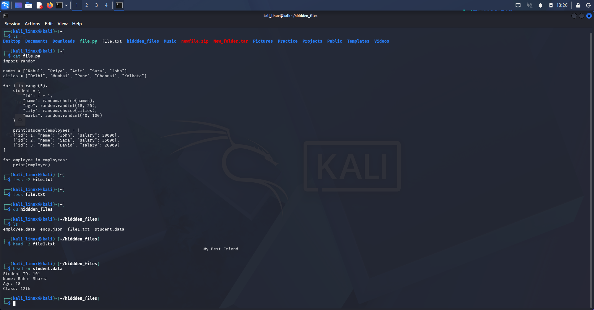
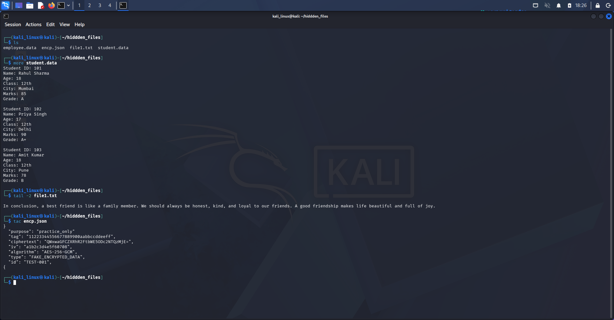

# Linux Viewing Files Commands

## 1. Introduction

Linux file-viewing commands help users read and inspect the contents of files from the terminal. Some commands display the whole file, while others let users view a file page by page or show only the beginning or end of a file.

In this section, I practiced file-viewing commands using Kali Linux.

## 2. Commands Learned

### 1. `cat`

**Description:** Displays the contents of a file in the terminal.

**Syntax:**
```bash
cat filename
```

**Example:**
```bash
cat notes.txt
```

**Use:** Reads and displays the file content. It is most convenient for short files.

### 2. `tac`

**Description:** Displays a file's lines in reverse order, starting with the last line.

**Syntax:**
```bash
tac filename
```

**Example:**
```bash
tac notes.txt
```

**Use:** Shows the lines from bottom to top. It does not reverse the characters within each line.

### 3. `less`

**Description:** Opens a file in an interactive viewer so you can read it one screen at a time.

**Syntax:**
```bash
less filename
```

**Example:**
```bash
less notes.txt
```

**Use:** Useful for reading long files. Press `q` to quit, and use the arrow keys or Page Up/Page Down to move through the file.

### 4. `more`

**Description:** Displays a file one screen at a time, moving forward through the content.

**Syntax:**
```bash
more filename
```

**Example:**
```bash
more notes.txt
```

**Use:** Helps read long files page by page. Press `Space` to move to the next screen; press `q` to quit when supported.

### 5. `head`

**Description:** Displays the first lines of a file. By default, it shows the first 10 lines.

**Syntax:**
```bash
head filename
```

**Example:**
```bash
head notes.txt
head -n 5 notes.txt
```

**Use:** Quickly checks the beginning of a file. The `-n 5` option displays the first 5 lines.

### 6. `tail`

**Description:** Displays the last lines of a file. By default, it shows the last 10 lines.

**Syntax:**
```bash
tail filename
```

**Example:**
```bash
tail notes.txt
tail -n 5 notes.txt
```

**Use:** Quickly checks the end of a file. The `-n 5` option displays the last 5 lines.

---

## 3. Evidences

Screenshots of my practical Linux terminal exercises are stored in the screenshots/ directory.

### Screenshot 1: Linux Terminal



### Screenshot 2: Linux Terminal




## 5. What I Learned

- How to display file contents with `cat`.
- How to display file lines in reverse order with `tac`.
- How to read long files using `less` and `more`.
- How to view the beginning of a file using `head`.
- How to view the end of a file using `tail`.


---

**Learning Status:** Practiced

**Operating System:** Kali Linux

**Category:** Linux Fundamentals
