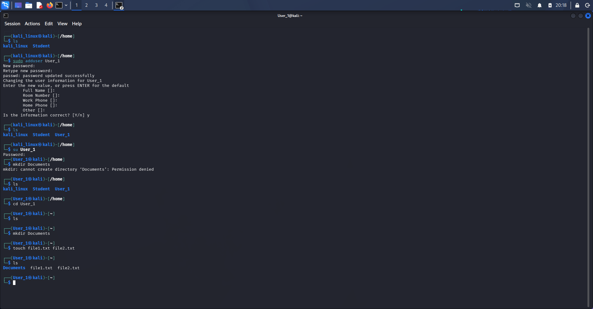
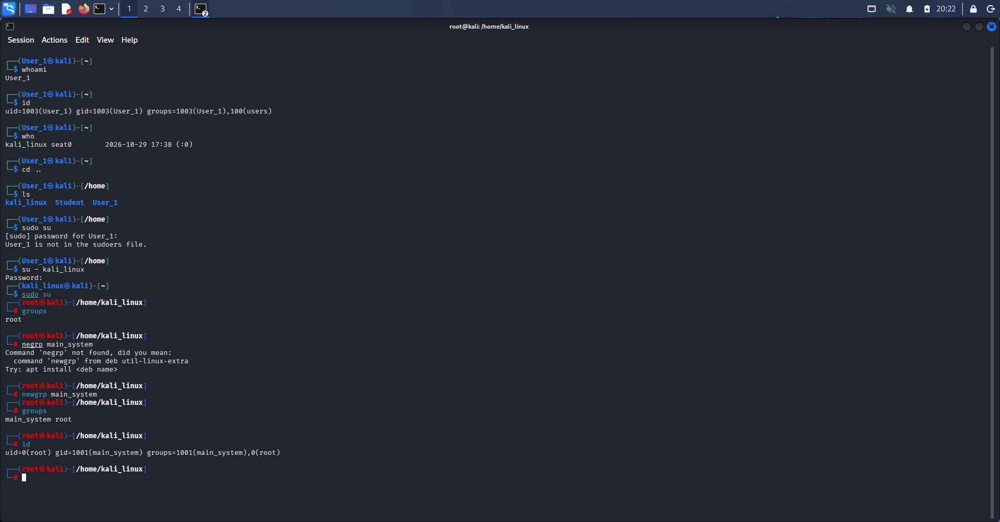
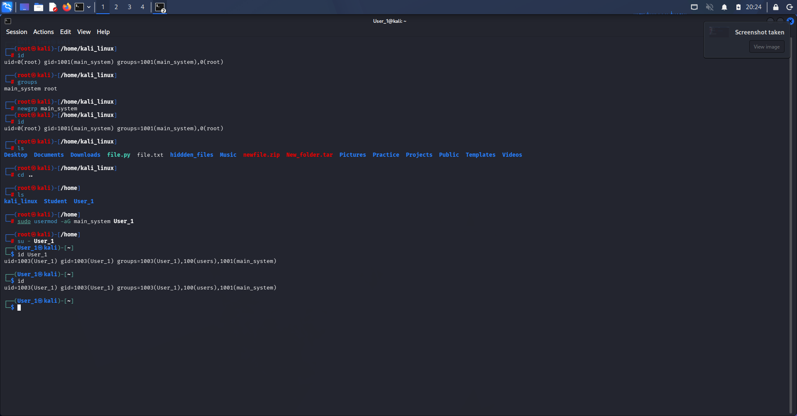

# Linux User Management

## 1. Introduction

User management in Linux allows users to create, delete, modify, and manage user accounts. It also helps administrators control user access and permissions within the system.

In this section, I practiced basic user management commands using Kali Linux.

## 2. Commands Learned

### 1. `adduser`

**Description:** Creates a new user account.

**Syntax:**
```bash
sudo adduser username
```

**Example:**
```bash
sudo adduser john
```

**Use:** Creates a new user named `john` and sets up the user's home directory.

### 2. `usermod`

**Description:** Modifies an existing user account.

**Syntax:**
```bash
sudo usermod [options] username
```

**Example:**
```bash
sudo usermod -aG sudo john
```

**Use:** Adds the user `john` to the `sudo` group, allowing the user to run administrative commands.

### 3. `passwd`

**Description:** Creates or changes a user's password.

**Syntax:**
```bash
sudo passwd username
```

**Example:**
```bash
sudo passwd john
```

**Use:** Sets or changes the password of the specified user.

### 4. `who`

**Description:** Displays information about users currently logged into the system.

**Syntax:**
```bash
who
```

**Use:** Shows the users who are currently logged into the system.

### 5. `whoami`

**Description:** Displays the username of the currently logged-in user.

**Syntax:**
```bash
whoami
```

**Use:** Shows the username of the current user.

### 6. `who am i`

**Description:** Displays information about the current terminal login session.

**Syntax:**
```bash
who am i
```

**Use:** Shows login information, such as the username, terminal, and login time.

### 7. `id`

**Description:** Displays the user ID (UID), group ID (GID), and group memberships.

**Syntax:**
```bash
id username
```

**Example:**
```bash
id john
```

**Use:** Shows the UID, primary GID, and groups associated with the specified user.

### 8. `su`

**Description:** Switches from the current user account to another user account.

**Syntax:**
```bash
su username
```

**Example:**
```bash
su john
```

**Use:** Switches to the specified user account. You may need to enter that user's password.

### 9. `userdel`

**Description:** Deletes an existing user account.

**Syntax:**
```bash
sudo userdel username
```

**Example:**
```bash
sudo userdel john
```

**Use:** Deletes the specified user account. The user's home directory is not removed by default.

### 10. `deluser`

**Description:** Deletes a user account using the Debian-based user management command.

**Syntax:**
```bash
sudo deluser username
```

**Example:**
```bash
sudo deluser john
```

**Use:** Removes the specified user account from the system.

### 11. `rm -r`

**Description:** Removes a directory and its contents recursively.

**Syntax:**
```bash
sudo rm -r /home/username
```

**Example:**
```bash
sudo rm -r /home/john
```

**Use:** Removes the remaining home directory and its contents after deleting a user account.

**Note:** Be careful when using this command because it permanently deletes the specified directory and its contents.

### 12. `cat /etc/passwd`

**Description:** Displays user account information stored in the `/etc/passwd` file.

**Syntax:**
```bash
cat /etc/passwd
```

**Use:** Shows local user account entries, including usernames, UIDs, GIDs, and home directory locations.

## 3. Evidences

Screenshots of my practical Linux user management exercises are stored in the `Evidence_image/` directory.

### Screenshot 1: Linux Terminal



### Screenshot 2: Linux Terminal



### Screenshot 3: Linux Terminal



---

## 4. What I Learned

- How to create new Linux user accounts.
- How to modify existing user accounts.
- How to create and change user passwords.
- How to check currently logged-in users.
- How to identify the current logged-in user.
- How to check user IDs and group memberships.
- How to switch between different user accounts.
- How to delete Linux user accounts.
- How to remove remaining home directories.
- How to view user account information.

---

**Learning Status:** Practiced

**Operating System:** Kali Linux

**Category:** Linux Fundamentals