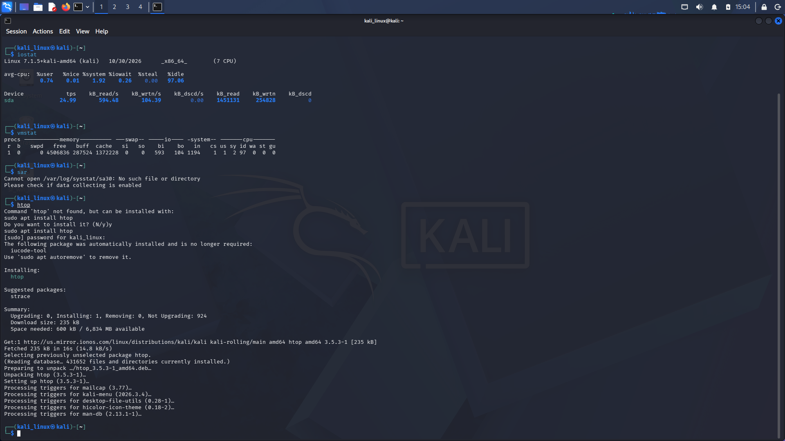
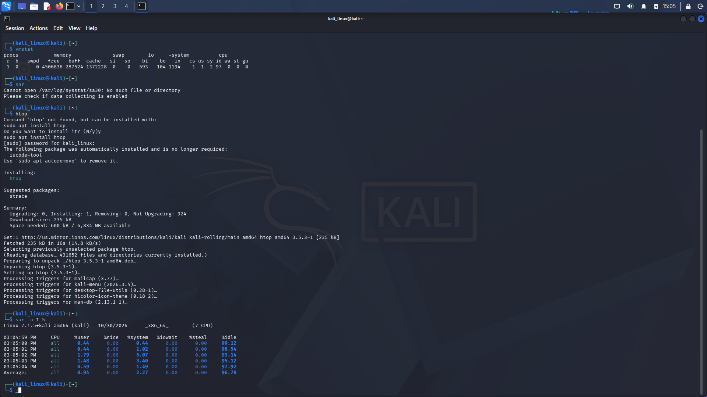

# Linux Performance Monitoring

## 1. Introduction

Performance monitoring in Linux helps users check and monitor system resources such as CPU, memory, and disk I/O.

Linux provides different commands to monitor system performance and understand how system resources are being used.

In this section, I practiced basic Linux performance monitoring commands using Kali Linux.

## 2. Commands Learned

### 1. `free`

**Description:** Displays memory usage information, including total, used, and available memory.

**Syntax:**
```bash
free
```

**Example:**
```bash
free
free -h
```

**Use:** Displays RAM and swap memory usage. The `-h` option shows memory values in a human-readable format such as MB and GB.

### 2. `uptime`

**Description:** Displays how long the system has been running since its last startup.

**Syntax:**
```bash
uptime
```

**Example:**
```bash
uptime
```

**Use:** Shows system uptime, the number of logged-in users, and system load averages.

### 3. `iostat`

**Description:** Displays CPU and input/output (I/O) statistics.

**Syntax:**
```bash
iostat
```

**Example:**
```bash
iostat
```

**Use:** Helps monitor CPU activity and disk input/output performance.

### 4. `vmstat`

**Description:** Displays virtual memory, CPU, processes, and system performance statistics.

**Syntax:**
```bash
vmstat
```

**Example:**
```bash
vmstat
vmstat 1 5
```

**Use:** Helps monitor memory usage, CPU activity, processes, and system performance. The `1 5` option displays statistics every 1 second for 5 reports.

### 5. `sar`

**Description:** Collects and displays system performance data.

**Syntax:**
```bash
sar
```

**Example:**
```bash
sar -u
sar -u 1 5
```

**Use:** Helps monitor CPU performance and system activity. The `-u` option displays CPU usage statistics. The `1 5` option displays performance data every 1 second for 5 reports.

### 6. `htop`

**Description:** Provides an interactive, real-time system monitoring interface.

**Syntax:**
```bash
htop
```

**Example:**
```bash
htop
```

**Use:** Displays real-time CPU usage, memory usage, running processes, and system resource information.

---

## 3. Evidences

Screenshots of my practical Linux performance monitoring exercises are stored in the `Evidence_image/` directory.

### Screenshot 1: Linux Terminal



### Screenshot 2: Linux Terminal




---

## 4. What I Learned

- How to check memory usage using the `free` command.
- How to check system uptime using the `uptime` command.
- How to monitor disk I/O statistics using the `iostat` command.
- How to check virtual memory and CPU statistics using `vmstat`.
- How to monitor CPU performance using the `sar` command.
- How to monitor system resources in real time using `htop`.
- How to understand basic Linux system performance monitoring.

---

**Learning Status:** Practiced

**Operating System:** Kali Linux

**Category:** Linux Fundamentals