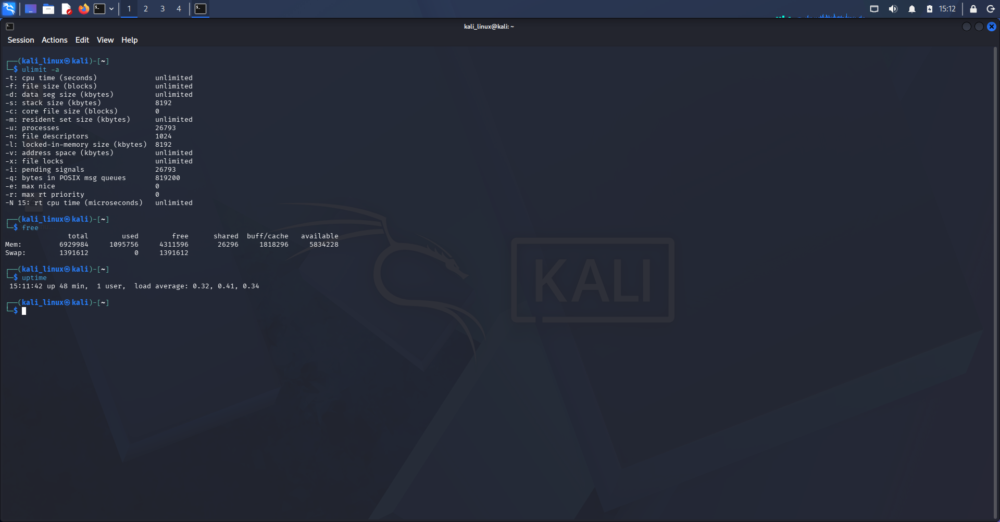
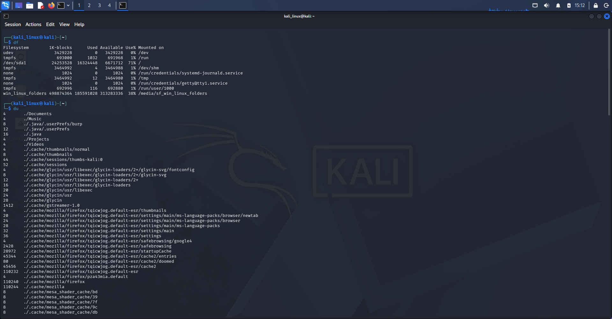

# Linux System Resources

## 1. Introduction

System resources in Linux include disk space, memory (RAM), CPU, and other resources used by the operating system.

Linux provides different commands to check, manage, and monitor system resources. These commands help users understand how system resources are being used.

In this section, I practiced basic Linux system resource commands using Kali Linux.

## 2. Commands Learned

### 1. `df`

**Description:** Displays disk space usage of file systems.

**Syntax:**
```bash
df
```

**Examples:**
```bash
df
df -h
```

**Use:** Shows total disk space, used space, available space, and mounted file systems. The `-h` option displays sizes in a human-readable format such as MB and GB.

### 2. `du`

**Description:** Displays the disk space used by files and directories.

**Syntax:**
```bash
du directory_name
```

**Examples:**
```bash
du Documents
du -h Documents
du -sh Documents
```

**Use:** Shows how much disk space a directory uses. The `-h` option displays human-readable sizes, and `-s` shows only the total size.

### 3. `ulimit`

**Description:** Displays or sets resource limits for the current shell and its processes.

**Syntax:**
```bash
ulimit
```

**Examples:**
```bash
ulimit -a
ulimit -n
ulimit -u
```

**Use:** Displays resource limits such as the maximum number of open files, user processes, and other system resources. The `-a` option displays all available limits.

### 4. `free`

**Description:** Displays memory (RAM) and swap memory usage information.

**Syntax:**
```bash
free
```

**Examples:**
```bash
free
free -h
```

**Use:** Shows total, used, free, and available memory. The `-h` option displays memory information in a human-readable format.

### 5. `watch`

**Description:** Repeatedly runs a command and displays its output at regular intervals.

**Syntax:**
```bash
watch command
```

**Examples:**
```bash
watch free -h
watch -n 2 df -h
watch -n 1 uptime
```

**Use:** Helps monitor changes in system resources by repeatedly executing a command. The `-n` option sets the update interval in seconds.

### 6. `uptime`

**Description:** Displays how long the system has been running since its last startup.

**Syntax:**
```bash
uptime
```

**Example:**
```bash
uptime
```

**Use:** Shows system running time, logged-in users, and system load averages.

---

## 3. Evidences

Screenshots of my practical Linux system resource exercises are stored in the `Evidence_image/` directory.

### Screenshot 1: Linux Terminal



### Screenshot 2: Linux Terminal



---

## 4. What I Learned

- How to check disk space usage using the `df` command.
- How to check directory size using the `du` command.
- How to view system resource limits using the `ulimit` command.
- How to check RAM and swap memory usage using the `free` command.
- How to monitor changing system information using the `watch` command.
- How to check system uptime using the `uptime` command.
- How to understand basic Linux system resource management.

---

**Learning Status:** Practiced

**Operating System:** Kali Linux

**Category:** Linux Fundamentals