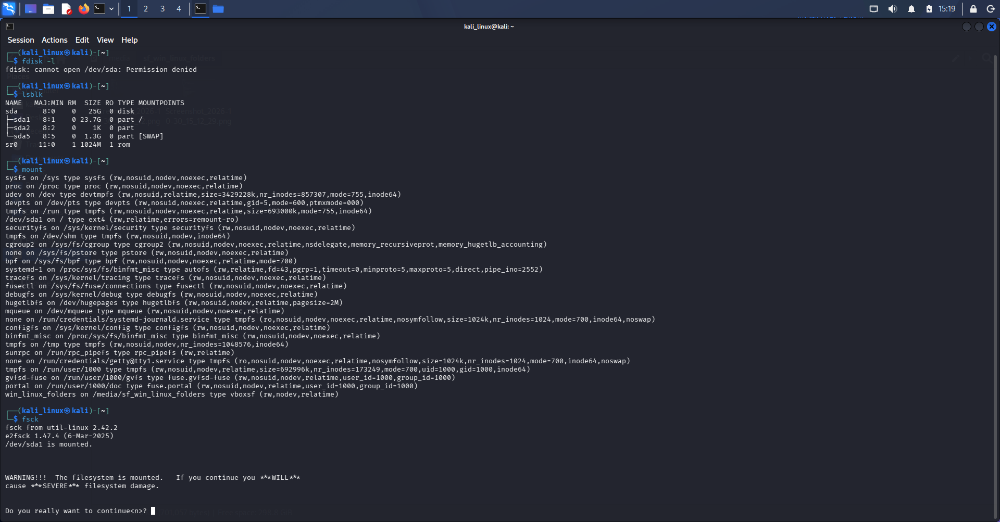
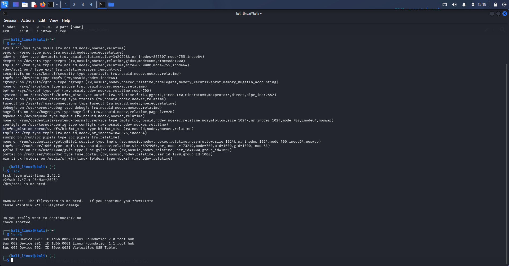

# Linux Disk Management

## 1. Introduction

Disk management in Linux helps users manage storage devices, partitions, and file systems.

Linux provides different commands to view disk devices, create and manage partitions, mount and unmount file systems, and check file system errors.

In this section, I practiced basic Linux disk management commands using Kali Linux.

## 2. Commands Learned

### 1. `fdisk`

**Description:** A disk partition management tool used to view, create, delete, and modify disk partitions.

**Syntax:**
```bash
sudo fdisk [option] device_name
```

**Examples:**
```bash
sudo fdisk -l
sudo fdisk /dev/sda
```

**Use:** Displays disk partition information using `-l`. It also allows users to manage disk partitions interactively.

**Note:** Be careful when modifying partitions because incorrect changes can cause data loss.

### 2. `lsblk`

**Description:** Lists information about available block devices, such as hard drives, SSDs, and USB storage devices.

**Syntax:**
```bash
lsblk
```

**Examples:**
```bash
lsblk
lsblk -f
lsblk -a
```

**Use:** Displays connected storage devices, partitions, mount points, and file system information.

### 3. `mount`

**Description:** Attaches a file system to a specific directory called a mount point.

**Syntax:**
```bash
sudo mount device_name mount_point
```

**Example:**
```bash
sudo mount /dev/sdb1 /mnt
```

**Use:** Makes the contents of a storage device accessible through the specified directory.

### 4. `umount`

**Description:** Detaches a mounted file system from its mount point.

**Syntax:**
```bash
sudo umount mount_point
```

**Examples:**
```bash
sudo umount /mnt
sudo umount /dev/sdb1
```

**Use:** Safely unmounts a storage device or file system before disconnecting it.

### 5. `fsck`

**Description:** Checks and repairs file system errors on storage devices.

**Syntax:**
```bash
sudo fsck device_name
```

**Examples:**
```bash
sudo fsck /dev/sdb1
sudo fsck -f /dev/sdb1
```

**Use:** Checks a file system for errors and helps repair detected problems. The `-f` option forces a file system check.

**Note:** Make sure the file system is unmounted before running repair operations. Always check the correct device name before using this command.

### 6. `lsusb`

**Description:** Displays information about USB devices connected to the system.

**Syntax:**
```bash
lsusb
```

**Examples:**
```bash
lsusb
lsusb -t
```

**Use:** Lists connected USB devices, including USB storage devices and other USB hardware.

---

## 3. Evidences

Screenshots of my practical Linux disk management exercises are stored in the `Evidence_image/` directory.

### Screenshot 1: Linux Terminal



### Screenshot 2: Linux Terminal



---

## 4. What I Learned

- How to view and manage disk partitions using the `fdisk` command.
- How to list storage devices using the `lsblk` command.
- How to mount file systems using the `mount` command.
- How to unmount file systems using the `umount` command.
- How to check and repair file system errors using the `fsck` command.
- How to identify connected USB devices using the `lsusb` command.
- How to understand basic Linux disk management.

---

**Learning Status:** Practiced

**Operating System:** Kali Linux

**Category:** Linux Fundamentals